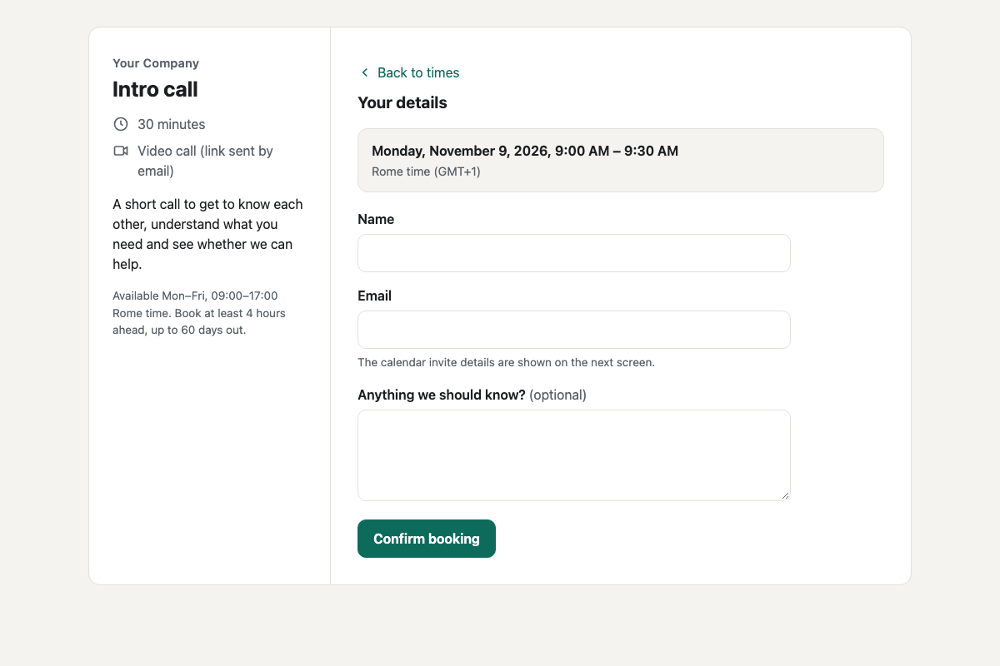

# A booking page, rebuilt with Claude Code

The core of a paid scheduling tool, rebuilt from one prompt: a page where visitors book a 30-minute call. One self-contained `index.html`, no libraries and no server.

## The result

| | |
|---|---|
| Time | 4 minutes (244 seconds) |
| Cost of AI | $1.22 |
| Model | Claude Opus 5.5 in Claude Code |

The exact prompt is in [`PROMPT.md`](PROMPT.md).

## What it does

- Availability on weekdays from 9:00 to 17:00 (Rome time), 30-minute slots, at least 4 hours' notice, up to 60 days ahead.
- A month calendar where only days with free slots can be chosen, keyboard included.
- The visitor's time zone is detected and can be changed; times are shown in the visitor's zone while the rules stay in the host's.
- A form with name, email and an optional note, and a confirmation screen with an `.ics` file and an "Add to Google Calendar" link.
- A slot cannot be booked twice in the same browser. Dark mode, reduced motion and phone layouts are supported.

## What it does not do

Everything that needs a server. Bookings stay in the visitor's own browser, so the host never sees them and two visitors could book the same slot. There is no sync with the host's calendar, no confirmation or reminder emails, no video-call link, no rescheduling and no admin view.

Our note: the screen is now the cheap part. What a scheduling tool charges for is everything behind it.

## How to use it

Open `index.html` in a browser. Company name, description, location and blocked dates are in the `CONFIG` block at the top of the script.

Set `location` to your own meeting link: the page sends no emails. Dates follow the visitor's browser language; the interface text is in English.

One change after the build: the default location no longer says that a link is sent by email, since the page sends none.

## License

MIT. Made by [Deploiable](https://deploiable.com), the AI product lab in Rome, for its series Rebuilt.
